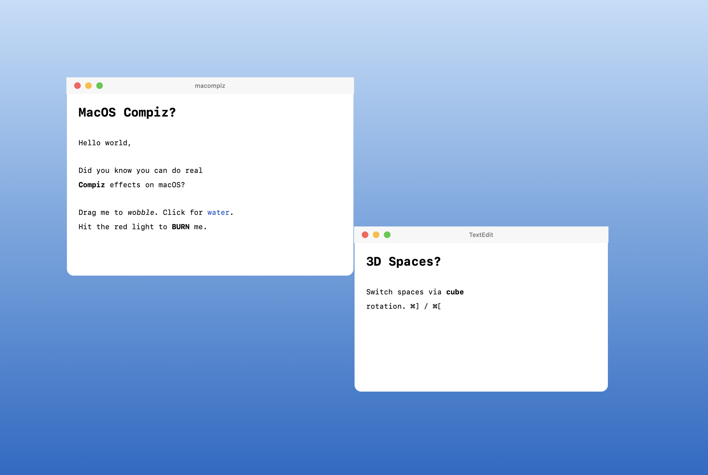
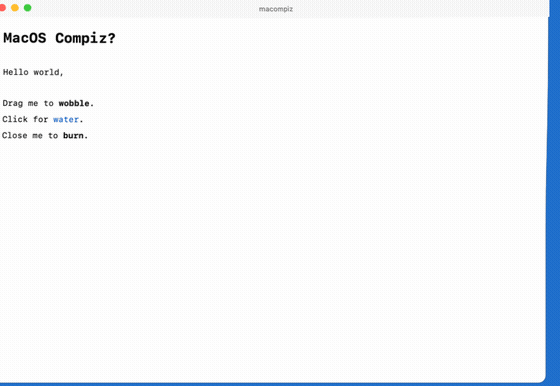
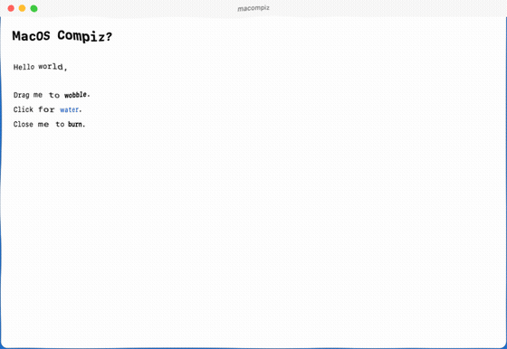
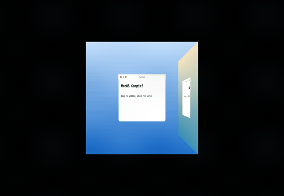
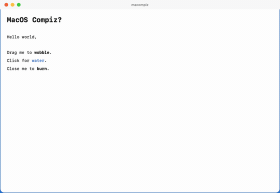
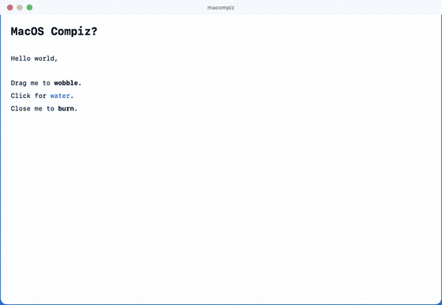
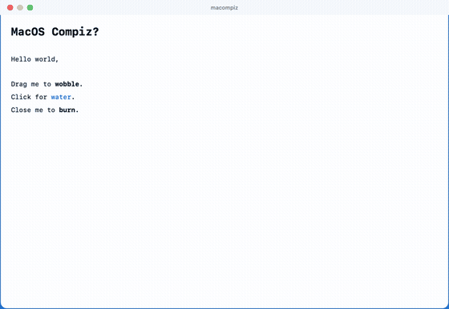
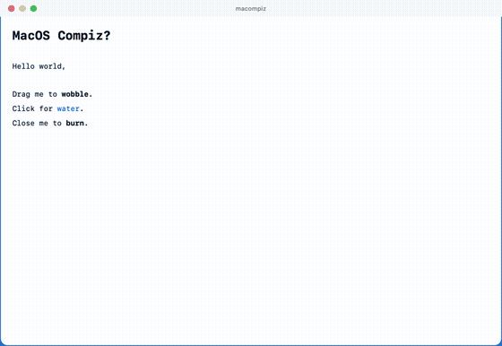
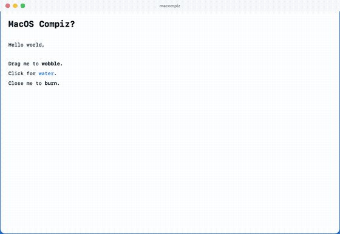
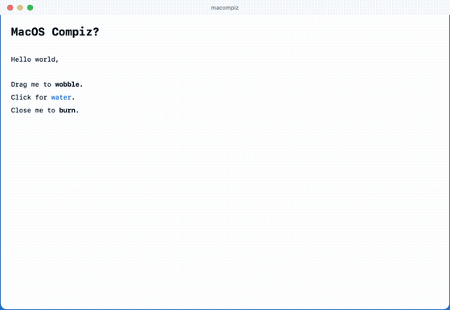

# macompiz

Compiz-style window effects on macOS — **wobbly windows**, a **burning** close
animation, **water** ripples, and a rotating **desktop cube** for switching
spaces. Inspired by [this demo](https://x.com/asciidiego/status/2113795531650818065)
by [@asciidiego](https://x.com/asciidiego).

It's a small AppKit + Metal app. The note windows are drawn by the app itself
(faux title bar + a tiny Markdown renderer), and a Metal pipeline distorts each
window's rendered texture in real time. Shaders are compiled **at runtime** from
source, so you only need a Swift toolchain — no full Xcode, no `metal` CLI.



## Effects in motion

All rendered straight from macompiz's own Metal pipelines (offscreen, no screen
capture) — regenerate with `scripts/make-gifs.sh`.

| Wobbly windows | Water / aquarium | Desktop cube |
| :---: | :---: | :---: |
|  |  |  |

| Burn | Glide | Explode |
| :---: | :---: | :---: |
|  |  |  |

| Magic Lamp | Sidekick | Curved Fold |
| :---: | :---: | :---: |
|  |  |  |

## What works

| Effect | Trigger |
| --- | --- |
| **Wobbly window** (jelly lag) | Drag a note by its body |
| **Water / aquarium** ripples | Click a note, or `Effects ▸ Splash` (`⌘W`) |
| **Desktop cube** space switch | `Effects ▸ Next/Prev space` (`⌘]` / `⌘[`) |
| **Markdown notes** | `#`/`##` headings, `**bold**`, `*italic*`, `` `code` `` |

Plus a set of **Compiz Fusion close animations**, selectable from the
*Animations* menu and run on the frontmost window (the red traffic light uses the
same set on a note):

| Animation | Key | Compiz Fusion original |
| --- | --- | --- |
| **Burn** | `⌘B` | Animation plugin "Burn" |
| **Glide** | `⌘1` | Animation "Glide" |
| **Explode** | `⌘2` | Animationaddon "Explode" |
| **Magic Lamp** | `⌘3` | "Magic Lamp" minimize genie |
| **Sidekick** | `⌘4` | Animation "Sidekick" (spin) |
| **Curved Fold** | `⌘5` | Animation "Curved Fold" |

The cube rotates a **real capture of your current desktop** (via
ScreenCaptureKit) away to reveal the next space. When you have more than one
macOS Space, macompiz uses the private **SkyLight** API to enumerate them and
switch for real — masking the switch behind a cover window and capturing the
*actual* destination desktop as the incoming face. If you only have one Space, or
the OS refuses the switch, it falls back to a synthetic desktop. All of this runs
with **SIP enabled**; going further (foreign-app windows, every face live) is the
[SIP route](docs/SIP.md).

## Run

```bash
swift run
```

Requires macOS 14+ and a Swift 6 toolchain (Command Line Tools is enough).

## How it works

- `NoteRenderer` rasterizes a note (title bar + Markdown body) into an `NSImage`.
- `GPU` compiles the Metal library from `Shaders.swift` at launch and uploads
  that image as a texture, plus a deformable triangle grid.
- `NoteMetalView` is a borderless `MTKView` window. The **vertex** shader
  displaces grid points for the wobble (the body lags behind the cursor); the
  **fragment** shader samples the texture with ripple offsets (water) and runs a
  noisy bottom-to-top front for the burn.
- `CubeView` renders two space textures on adjacent cube faces behind a
  perspective camera and rotates 90° to switch — the classic desktop cube.
- `ScreenCapture` grabs the live desktop with **ScreenCaptureKit**
  (`SCScreenshotManager`, a one-shot still) to use as the real outgoing cube
  face. It needs the **Screen Recording** permission; macOS prompts on first use,
  and if it's denied the cube falls back to a synthetic desktop.
- `SkyLight` resolves private `SLS*` symbols with `dlsym` at runtime (nothing
  private is linked at build time) to enumerate Spaces, read the active one, and
  attempt a real Space switch — all from our own process, SIP on. Everything is
  non-destructive; missing symbols or an OS refusal degrade to the synthetic cube.
- `CompositorBridge` / `YabaiBridge` relay the privileged foreign-window ops to an
  installed yabai; `NoteWindow(foreignTexture:frame:)` reuses the effect pipeline
  to burn a captured copy of another app's window. See *Foreign windows* above.

## Foreign windows (experimental)

`Effects ▸ Burn frontmost window` (`⌘B`) runs the burn on **another app's**
window. Since no app can run a shader inside a foreign window, it works by
capture-and-overlay:

1. enumerate on-screen windows and capture the target live (ScreenCaptureKit,
   SIP on — verified: see `--test-foreign`);
2. ask a **compositor bridge** to hide the real window (`setOpacity(0)`);
3. float a macompiz overlay of the captured pixels and burn *that*;
4. close the real window through the bridge when the burn finishes.

`CompositorBridge` has three implementations, picked best-first:

- **`AXBridge` (default, no SIP changes).** Uses the public **Accessibility**
  API. It can't do compositor opacity, so it *hides* the real window by moving it
  off-screen during the effect and *closes* it by pressing its close button at the
  end. Combined with the captured-copy overlay this gives the full
  **hide → animate → close** flow with **SIP enabled** — no yabai, no Recovery.
  Needs macompiz's own Accessibility permission (System Settings ▸ Privacy &
  Security ▸ Accessibility). **Verified on macOS 26 (SIP on): the real window is
  hidden during the burn and actually closed afterwards.**
- **`YabaiBridge`.** Drives an installed [yabai](https://github.com/koekeishiya/yabai).
  Only this adds *true compositor* opacity on the live window (no off-screen
  trick) — and that one feature needs yabai's scripting addition with SIP
  partially disabled (`yabai --load-sa`; see [docs/SIP.md](docs/SIP.md)). On
  current macOS with SIP on, yabai's own `--opacity`/`--close` are no-ops, so
  AXBridge is the one that actually works today.
- **`NullBridge`.** No helper at all — the effect plays as a **visual-only**
  overlay and the real window stays.

macompiz ships **no injector of its own**; the only SIP-gated path routes through
yabai, and the default path avoids it entirely.

Per-pixel effects (burn/wobble/water) on foreign windows only work through this
overlay path. Plain window ops (opacity, move, close) go straight through the
bridge to every window.

## Scope & the "real compositor" question

The original demo pokes at the macOS compositor directly. macompiz deliberately
stays in **user space with SIP enabled**: every pixel it distorts is a window it
drew itself, so it needs no entitlements, no injection, and nothing breaks on a
macOS update.

Reaching *other* apps' windows is a different game: on macOS the `WindowServer`
is the compositor and an ordinary app can't restyle another app's windows. The
two established routes are **ScreenCaptureKit** (SIP-friendly, read-only — what
the cube uses to snapshot your desktop) and a **scripting addition loaded into
Dock/WindowServer** with SIP partially disabled, the approach
[yabai](https://github.com/koekeishiya/yabai) documents.

ScreenCaptureKit can only snapshot the space you're *currently* on; genuinely
peeking into other Spaces (to texture every cube face live) needs private
SkyLight APIs. That injection layer is intentionally **not** included here — see
yabai and [saagarjha's Spaces notes](https://news.ycombinator.com/item?id=23241073)
for prior art if you want to go there.

## License

MIT
